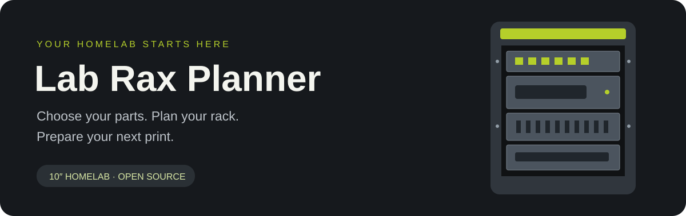

<p align="center">
  
</p>

# Lab Rax Planner

**Build your homelab on screen before you start printing.**

Choose community mounts, arrange your devices in a 10″ Lab Rax rack, preview the result and download a build pack with model links, custom STL files and a shopping list.

[**Open the planner →**](https://benna1990.github.io/lab-rax-planner/) · [Quick start](docs/QUICKSTART.md) · [Roadmap](ROADMAP.md) · [Report a problem](https://github.com/benna1990/lab-rax-planner/issues/new/choose)

[](https://github.com/benna1990/lab-rax-planner/actions/workflows/validate.yml)
[](LICENSE)
[](https://benna1990.github.io/lab-rax-planner/)

> **In active development.** Layouts, material quantities and cooling figures help you plan. Confirm model dimensions and slice the selected files before buying materials or printing. The current rack family is Lab Rax 10″.

## What can you do?

| Plan | Preview | Prepare |
| --- | --- | --- |
| Browse hundreds of community mounts and panels | Switch between front, 3D and airflow views | Download a build pack for your layout |
| Arrange devices in a 1–10U rack, front and back | Load your downloaded STL/3MF files locally | Find source models through a download checklist |
| Choose a frame, colours and side panels | Explore approximate airflow and temperatures | Get a shopping list and build instructions |
| Save a layout as a `.rack.json` file and open it again | Check which parts fit your printer’s bed | See which prints are too big before you slice |
| Generate blank, vent, keystone, label and shelf parts | Change device heat and fan direction | Export generated parts as STL |

The catalog includes network gear, mini PCs, Raspberry Pi boards, drive bays, patch panels, cooling parts and frame accessories. Each community entry links back to its maker’s model page.

## Your first rack

1. **[Open the planner](https://benna1990.github.io/lab-rax-planner/)** and choose **Set up a rack** to start your own layout.
2. **Add your devices and panels.** Adjust the rack height and arrange the parts. ≈ marks an estimated height.
3. **Check your build.** Review the 3D preview, cooling estimate, print list and shopping list.
4. **Download the build pack.** Open the community model links, select the correct variants and slice the files for your printer.

No account or application installation is needed to use the planner. See the [step-by-step guide](docs/QUICKSTART.md) for downloads, custom parts and sharing.

## What is in the build pack?

- **Custom STL files** for parts generated in the planner.
- **Build plan PDF**, when PDF generation succeeds.
- **Build guide** with assembly steps and a shopping list.
- **Download checklist** linking to community model pages.
- **Print and shopping lists** in CSV, plus a README.
- **Rack file** (`<name>-<height>u.rack.json`) to open the layout in the planner again.

Community STL/3MF files are downloaded from their original pages and retain their own licenses. They are not bundled in this repository or redistributed in the build pack.

## Current status

| Feature | Status |
| --- | --- |
| Layout editor, community catalog and custom STL generation | Available |
| 3D preview and local STL/3MF preview | Available; previews do not certify fit |
| Shopping list and assembly guide | Available; verify against selected model variants |
| Filament per colour | Rough estimate, including a spare allowance |
| Cooling and airflow | Simplified estimate; see [assumptions below](#cooling-estimate) |
| Power draw, PoE budget, network ports and UPS runtime | Planning estimate; see [Power budget](#power-budget) |
| Print time and full build cost | Planned |
| Acrylic sides | Material choice and supplier links; measured cutting files still needed |
| Cheapest delivered acrylic quote by country | Planned |

Our aim is one simple route from choosing devices to a complete print and build plan. The next steps are verified dimensions, reliable print profiles, costs and made-to-measure acrylic ordering. Follow the [roadmap](ROADMAP.md) for the implementation work.

## Documentation

- [Quick start and common questions](docs/QUICKSTART.md)
- [Dimensions and frame assumptions](#dimensions)
- [How the cooling estimate works](#cooling-estimate)
- [Add a model or contribute code](CONTRIBUTING.md)
- [Development roadmap](ROADMAP.md)
- [Credits and licenses](#credits-and-licenses)

## Run locally

Requires Python 3. There is no build step or package installation.

```sh
git clone https://github.com/benna1990/lab-rax-planner.git
cd lab-rax-planner
python3 -m http.server 8000
```

Open [localhost:8000](http://localhost:8000). Serve the folder over HTTP: opening `index.html` directly cannot load the catalog.

The app uses plain HTML, CSS and JavaScript. Browser storage keeps your layout locally. 3D and PDF features load libraries from external CDNs; community and shopping links open external sites.

To run the repository checks with Node.js:

```sh
node tools/validate.mjs
for f in app.js parts.js shapes.js view3d.js pdf.js airflow.js power.js guide.js estimate.js market.js printers.js; do node --check "$f"; done
node tools/test-power.mjs
node tools/test-printers.mjs
```

## Help improve the planner

Found a mount, checked a dimension or printed a working build? [Suggest a model](https://github.com/benna1990/lab-rax-planner/issues/new/choose) or read [CONTRIBUTING.md](CONTRIBUTING.md). Model links, measured dimensions, slicer results and photos of completed builds are especially useful.

## Dimensions

| What | Value | Source |
|---|---|---|
| Rack unit | 44.45 mm | 10″/19″ standard; Lab Rax article |
| Panel height | n × 44.45 − 0.79 mm (1U = 43.66 mm) | EIA-310 clearance |
| Hole pattern per U | 6.35 / 22.225 / 38.1 mm | EIA-310 |
| Hole spacing, centre to centre | 236.525 mm | Lab Rax article |
| Clear width between posts | 222 mm | Lab Rax article |
| Screws | M6 (×10 with inserts, ×12 bolted), inserts 8 mm OD, 4–5 mm, hole 5.5 mm deep | Lab Rax article, MakerWorld pages |
| Side edge pieces | 170 mm | “Lab Rax deeper sides” remix |
| Total depth | ≈ 240 mm | depth-spacer remix (beam = depth − 70 mm) |
| Top panel | ≈ 228 × 171.5 mm | U7 Pro top-mount page |
| Outer width | ≈ 280 mm | LowProfile remix (280 × 240 mm) |
| Printed panel width (custom parts) | 250 mm | chosen to fit a 256 mm bed and reach past the holes |
| Keystone cut-out | 14.9 × 16.4 mm in a 2 mm plate | module face 14.5 × 16.0 mm |

### Print bed check

Pick your printer in the print list (or in **Set up a rack**) and every print that has a part too big for its bed is marked, in the planner, the PDF and the build pack lists. A part fits when it lies flat on the bed, straight or turned; long, narrow parts often fit only diagonally. The printer is a setting of your browser, not part of the layout. Presets and the check are in `printers.js`; the sizes come from these assumptions (≈ is an estimate):

| Part | Size used | Source |
|---|---|---|
| Horizontal pieces | ≈ 280 × 32 mm (outer width × ring) | they only fit a 256 mm bed diagonally and not a 220 mm bed (Lab Rax article and comments) |
| Posts and side panels | ≈ n × 44.45 mm long (5U at most), posts 26 mm wide, side panels 170 mm deep | “5U being the largest that fits a 250 mm print bed” (Lab Rax article) |
| Top and bottom panel | ≈ 228 × 171.5 mm | top panel above |
| Catalog panels and mounts | ≈ 254 mm × panel height | a full 10″ front; check the model, many are narrower |
| Custom parts | 250 mm × panel height; shelves also their depth | `parts.js` |

The 3D frame follows the photos in the Lab Rax article: bevelled top and bottom rings with mitred corners, the hex grille and logo on the front bevel, arched handles, posts with inserts and tinted side panels. Ring sizes, post section, handles and feet are estimates. They live in `FRAME` at the top of `view3d.js`; correct them there when you measure the original files (keep downloaded model files in `reference/`, which git ignores).

## Cooling estimate

`airflow.js` estimates how warm the air in the rack gets. It is a quick physical model, not CFD, so treat the numbers as a guide.

- **Heat.** Each part's `watts` in `catalog.json` is its typical draw in a home lab under light load, from spec sheets and wall-meter measurements. A switch counts its own draw, not its PoE budget, and a power supply only its losses. ≈ marks an estimate. A part's own value always wins.
- **Layers.** The rack is split into ½U layers, each with one air temperature. Air that comes in through an opening is at room temperature (25 °C unless you change it).
- **Stack effect.** Warm air is lighter, so the pressure inside rises faster with height than outside. Low openings take air in, high ones let it out. An open back does both, split at the neutral plane (the dashed line in the Airflow view). Panels on the rear posts close the back where they sit: their vents count as openings in the back, and their fans blow out by default. Openings follow orifice flow with a discharge coefficient of 0.6, and the seams between panels leak a little.
- **Fans.** Each fan follows a straight fan curve from its rated flow and maximum static pressure, at full speed, minus 15 % for the grille. It pushes against whatever pressure the openings leave. Typical figures: 40 mm 6 CFM, 80 mm 30, 92 mm 40, 120 mm 52, 140 mm 75, 200 mm 86 CFM (1 CFM = 1.7 m³/h).
- **Heat balance.** In every layer the parts' heat is carried off by the air flowing through it. Warm air under cooler air turns over and mixes upward, warm air above cooler air stays put, and about 4 W per m² per °C leaks through the printed walls. Pressure and temperature depend on each other, so the model solves them in turn until they settle.
- **Not included.** The devices' own fans (which usually help), draughts and air conditioning in the room, sunlight, and how hot a device runs inside. The temperatures are of the air around the parts. Most network gear and mini PCs are rated for air up to 40 °C, so the planner calls a rack cool up to 35 °C, warm up to 40 °C and hot above that.

## Power budget

`power.js` adds up what the rack needs, in the **Power & network** section of Your build and in the build plan PDF.

- **Draw.** The same typical `watts` per part as the cooling estimate, plus 5 V fans and PoE devices outside the rack that you add. A PoE switch's own draw leaves out what it sends over PoE, so the devices on PoE count with their own draw, plus about 10 % lost in the switch's power supply. Start-up and full load can be two to three times the typical figure.
- **PoE.** Switches, gateways and injectors with `poe` give a budget, a number of PoE ports and a standard (PoE, PoE+, PoE++). Devices with `poeIn` take one port and their maximum draw from the spec sheet. The planner hands them out biggest first and warns when the budget, the ports or the standard run short, with an injector or a bigger switch to fix it; the shopping list then gets the injectors. A Raspberry Pi switched to PoE gets a PoE+ HAT instead of its USB-C supply.
- **Network ports.** Every device with a network cable takes a switch port; switches and routers offer theirs (`ports`, or the RJ45 and SFP in their `io`), and each extra one links to another with a port at both ends. Keystone jacks are listed next to the free ports.
- **UPS.** Enter a size in VA or Wh. A lead-acid battery of about 0.125 Wh per VA, an 85 % inverter, 5 W for the UPS itself and Peukert's law (k = 1.2) give the runtime at the rack's draw; about 0.6 W per VA is its watt rating.

## Add a device, mount or part

Edit **`catalog.json`** and see [CONTRIBUTING.md](CONTRIBUTING.md) for the format. Run `node tools/validate.mjs` before opening a pull request; GitHub runs it on every pull request.

## Shop and affiliate links

Every item on the shopping list links to a search at each shop in `catalog.json` → `shops` (Amazon, bol and AliExpress to start with; `{q}` is the search text). To earn from the links:

- **Amazon**: put your Associates tag in `shops.amazon.tag` (e.g. `yourname-21` for amazon.nl).
- **Other shops**: put the deep-link template from their partner programme in `wrap`, with `{url}` where the product link goes.

When any tag or template is set, the planner and the build guide show an affiliate disclosure (and Amazon's own sentence when the Amazon tag is set). Hardware lives in `catalog.json` → `hardware`, with a spec, pack size, shop search text and, for fans, a quiet and a budget model. Handy extras and build tips come from `tips.json`.

## Credits and licenses

- Lab Rax is designed by [Michael Klements](https://the-diy-life.com/) and published on [MakerWorld](https://makerworld.com/en/models/1294480).
- Every model in the catalog belongs to its maker and keeps its own license (most use the MakerWorld licence, which does not allow redistribution). This project only links to them and never stores or redistributes their files.
- Custom parts are original designs generated from the open 10″ rack standard.
- The planner is released under the [MIT License](LICENSE).
